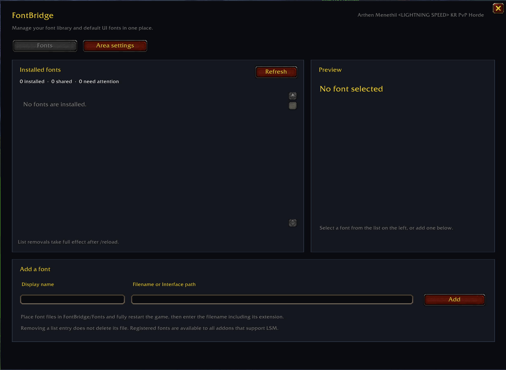
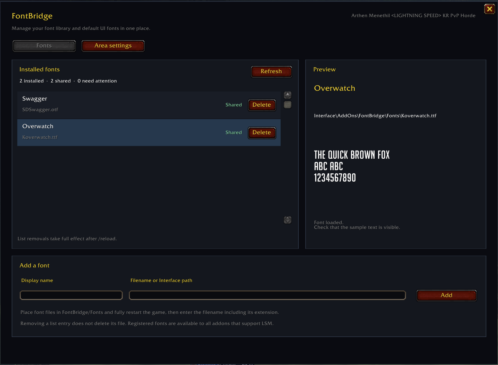
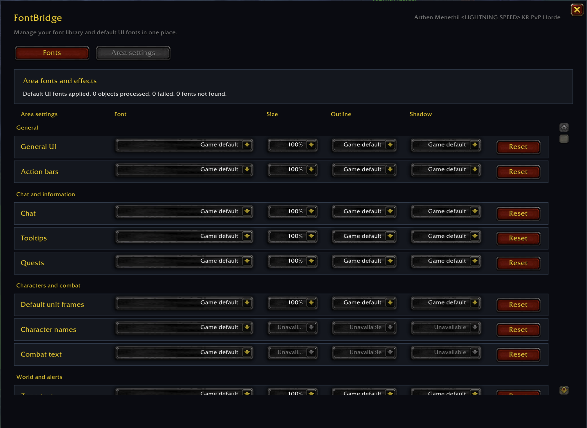

# FontBridge

**Register user-provided fonts with LibSharedMedia and manage fonts for Blizzard UI areas in WoW Forever.**

FontBridge is a standalone addon for World of Warcraft Forever. It adds your own font files to [LibSharedMedia-3.0](https://www.curseforge.com/wow/addons/libsharedmedia-3-0), so any addon that uses LibSharedMedia can offer them in its font selector. It also provides per-area font and style settings for supported Blizzard UI elements.

FontBridge does not modify other addons. Third-party addons keep their own font controls; select a registered font in each addon's settings.

## Features

- Register `.ttf` and `.otf` files with a display name.
- Share registered fonts with LibSharedMedia-compatible addons.
- Preview, refresh, and remove registered entries from the `/fb` window.
- Choose fonts for supported Blizzard UI areas, with scale, outline, and shadow options where the client supports them.
- Save font entries and area settings between sessions.
- Korean and English UI, with additional translations for the main interface.

## Screenshots

## Install

1. Extract the `FontBridge` folder into `World of Warcraft/_forever_/Interface/AddOns/`.
2. Enable FontBridge from the AddOns list at character selection.
3. Log in and type `/fb` to open its window.

The included release archive contains **no font files**. You must supply fonts that you are licensed to use.

## Build and release

Pull requests and pushes to `main` build a ZIP artifact. To publish a release, push a `v` tag that matches the version in `FontBridge.toc`. For version `2.2.3`, run `git tag v2.2.3` and `git push origin v2.2.3`. GitHub Actions builds the ZIP and attaches it to a GitHub Release.

## Add your own fonts

1. Copy `.ttf` or `.otf` files into `Interface/AddOns/FontBridge/Fonts/`, or keep them in another addon and use that addon's full `Interface\\AddOns\\...` path.
2. Fully exit and restart the game after copying a new font file. WoW discovers addon files at startup.
3. Open `/fb`, enter a display name and the font filename (or full Interface path), then choose **Add**.

Removing an entry from FontBridge does not delete its font file. LibSharedMedia has no unregister operation, so use `/reload` after removing an entry to clear it from other addons' lists for the current session.

## Choose fonts

Open `/fb` or `/fontbridge` and use **Area Settings** to choose fonts for supported Blizzard UI areas. Each area's help text describes what it controls. Area-wide font replacement pauses while another addon is changing the same Blizzard UI fonts; LibSharedMedia font sharing remains available.

For SUF, Bartender, and other third-party addons, open that addon's own settings and select the font registered by FontBridge. FontBridge does not replace third-party addon-specific font settings.

## Minimap button

Left-click the FontBridge minimap icon to open its window. Drag the icon to move it, or right-click it to hide it. Run `/fb minimap` to toggle the icon, or use `/fb minimap show` and `/fb minimap hide` to set its visibility.

## Troubleshooting

- **A font does not load:** Check its filename, extension, path, and game restart. The font must be readable by the WoW client.
- **The font appears in FontBridge but not another addon:** Confirm that the addon uses LibSharedMedia-3.0 and reload the UI after registration.
- **Some characters are missing:** The font file must contain the glyphs for those characters. FontBridge cannot add missing glyphs.
- **A new file is not listed:** Fully exit and restart WoW; `/reload` alone does not make a newly copied addon file available.

## Compatibility

This release targets WoW Forever interface `16001` (client build `1.60.1`, build `70862`). It bundles LibStub, CallbackHandler-1.0, and LibSharedMedia-3.0 so it can register fonts even when another addon does not load those libraries first.

## Credits and license

FontBridge author: **Arthen Menethil <LIGHTNING SPEED> KR PvP Horde**.

FontBridge-authored source and project documentation are licensed under MIT; see [LICENSE](LICENSE). Bundled libraries retain their own terms, listed in [THIRD_PARTY_NOTICES.md](THIRD_PARTY_NOTICES.md). The CurseForge listing icon stays in `assets/FontBridge-icon.png`; the resized `assets/FontBridge-icon.tga` texture is included for the minimap button. Screenshots are in `assets/` and included in the ZIP so they appear in this README.
